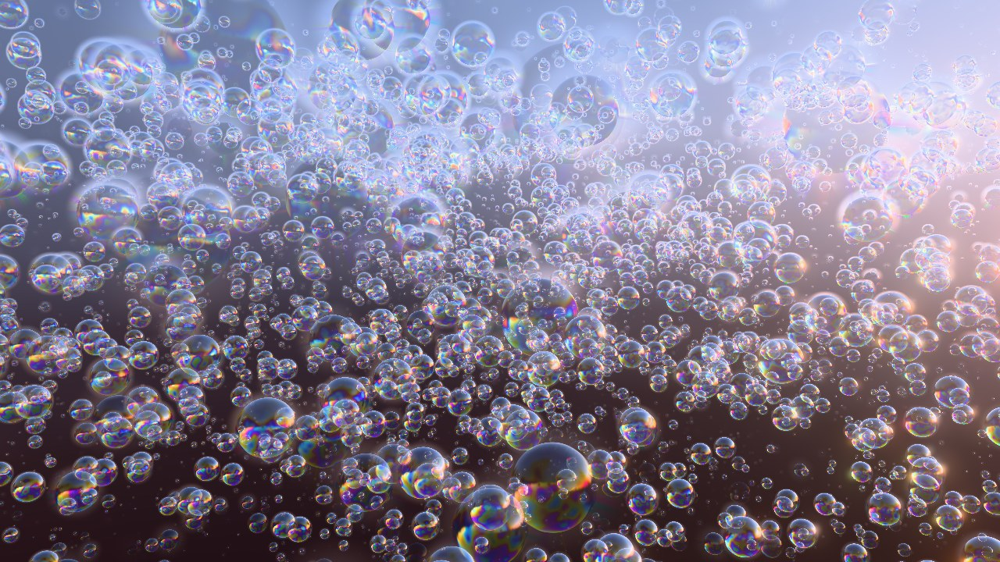
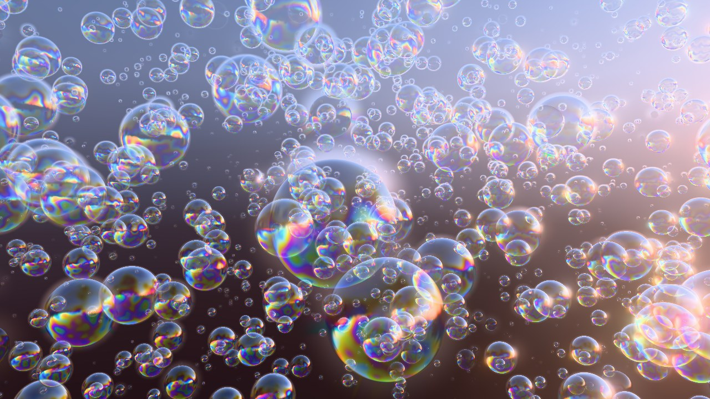
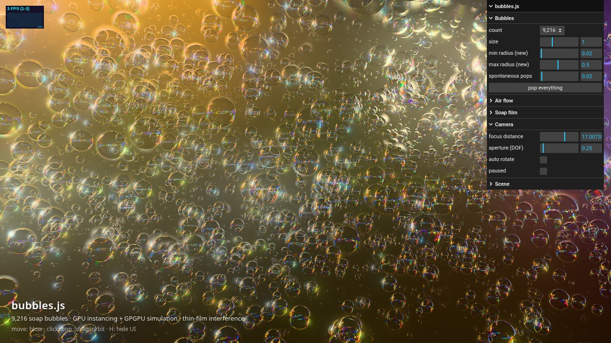
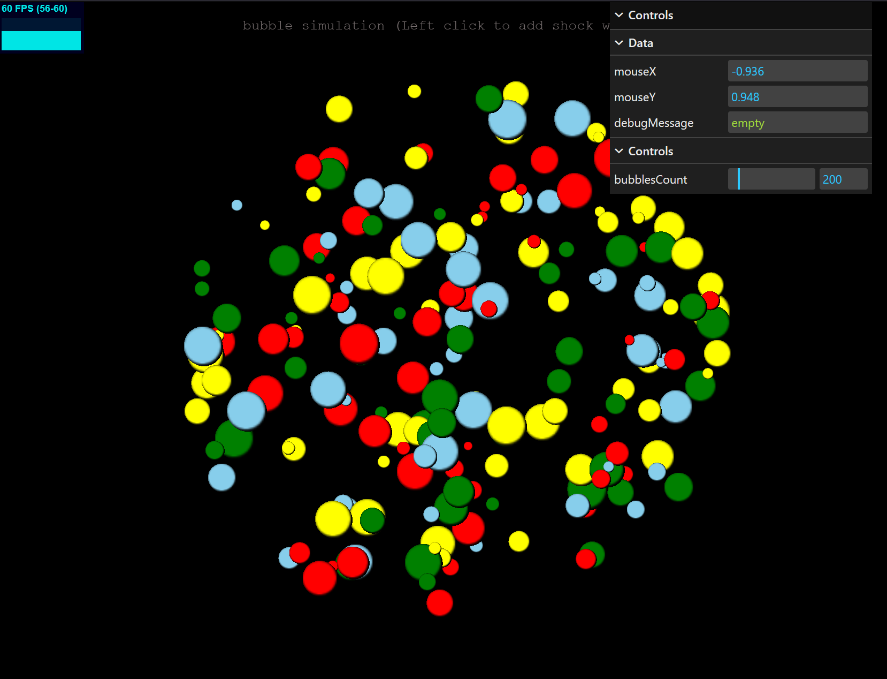

# bubbles.js

Thousands of iridescent soap bubbles, simulated and rendered entirely on the GPU with **Three.js**.
One instanced draw call, a GPGPU simulation in float textures, and a physically based
thin-film interference shader.



| Close-up | Night city + controls |
| --- | --- |
|  |  |

## Features

- **GPU simulation (GPGPU).** Each bubble is one texel in two ping-ponged float textures
  (position + radius, velocity + pop state), updated with `GPUComputationRenderer`.
  The CPU only sends a few uniforms per frame.
  - buoyancy that scales with bubble size, plus a divergence-free **curl-noise** air flow
  - soft walls that keep the swarm in frame, and recycling of bubbles that pop or float away
  - random spontaneous pops
- **GPU instancing.** All bubbles are drawn in a single instanced draw call (1k to 65k
  instances). Camera-facing quads are expanded in the vertex shader straight from the sim textures.
- **Per-pixel ray-traced spheres.** Each quad runs an analytic ray/sphere intersection
  and shades both the front and the back film surface.
- **Thin-film interference.** The Airy reflectance of a water film (n = 1.33) is computed for
  s and p polarisation and integrated over 8 wavelengths, using an analytic CIE 1931 fit
  converted to sRGB.
  - Film thickness drains under gravity (thin at the top, thick at the bottom) and swirls slowly with noise.
- **HDR image-based lighting.** Reflections of CC0 Poly Haven HDRIs, a pre-filtered copy for
  alias-free reflections, a blurred HDR background, bloom and neutral tone mapping.
- **Sprite depth of field.** Out-of-focus bubbles widen into soft, energy-conserving bokeh discs.
- **Interaction.**
  - Moving the pointer blows bubbles away.
  - Clicking pops bubbles: the film tears open with a bright rim and a pressure burst pushes the neighbours away.
  - Dragging orbits the camera.
- **lil-gui** panel for every parameter, plus an FPS counter (stats.js).

## Controls

| Input | Action |
| --- | --- |
| move pointer | wind that blows bubbles away |
| click | pop bubbles under the cursor |
| drag / scroll | orbit / zoom |
| `H` | hide or show the UI |

URL parameters (handy for screenshots):

- `?count=16,384` sets the bubble count. Options: 1,024 / 4,096 / 9,216 / 16,384 / 36,864 / 65,536.
- `?env=Night%20city` picks the environment: `Park sunset`, `Cloudy dawn` or `Night city`.
- `?cam=x,y,z` sets the camera position.
- `?warm=120` pre-simulates N steps before the first frame.
- `?ui=0` hides the UI.

Bubble size scales with count, so screen coverage stays about the same. More bubbles means smaller bubbles.

## Run

```bash
npm install
npm run dev      # http://localhost:5173
npm run build    # type-check + production build into dist/
```

You need a browser with WebGL 2 and float render targets, which any current desktop or mobile browser has.

## Project layout

```
src/
  main.ts                 scene, camera, post-processing, GUI, input, loop
  sim/Simulation.ts       GPGPU setup (GPUComputationRenderer) and per-frame uniforms
  render/Bubbles.ts       instanced geometry + bubble ShaderMaterial
  render/envBlur.ts       pre-filtered equirect HDR for reflections
  shaders/
    velocity.frag         forces: buoyancy, curl noise, walls, pointer wind, pops
    position.frag         integration + recycling
    bubble.vert / .frag   billboarding, ray/sphere hit, shading, DOF, pop effect
    thinfilm.glsl         spectral thin-film interference
    noise.glsl, curl.glsl simplex noise, hashes, curl noise
```

## History

The 2021 version rendered a few hundred flat coloured discs pushed apart by a brute-force
O(n²) GPU loop:



The 2026 rewrite moves to Vite + TypeScript and the latest Three.js. It adds 3D bubbles,
curl-noise flow, thin-film shading, HDR lighting, DOF, bloom and popping.

## Credits

- HDRIs from [Poly Haven](https://polyhaven.com), CC0:
  - [Rosendal Park Sunset](https://polyhaven.com/a/rosendal_park_sunset) by Dimitrios Savva & Jarod Guest
  - [Kloppenheim 06](https://polyhaven.com/a/kloppenheim_06) by Greg Zaal
  - [Shanghai Bund](https://polyhaven.com/a/shanghai_bund) by Greg Zaal
- Simplex noise: Ashima Arts / Stefan Gustavson (MIT). Hashes: Dave Hoskins, "Hash without Sine" (MIT).
- CIE colour-matching fit: Wyman, Sloan & Shirley, *Simple Analytic Approximations to the CIE XYZ
  Color Matching Functions*, JCGT 2013.
- Curl noise: Bridson, Hourihan & Nordenstam, *Curl-Noise for Procedural Fluid Flow*, SIGGRAPH 2007.

## License

MIT © Mike Smahin
